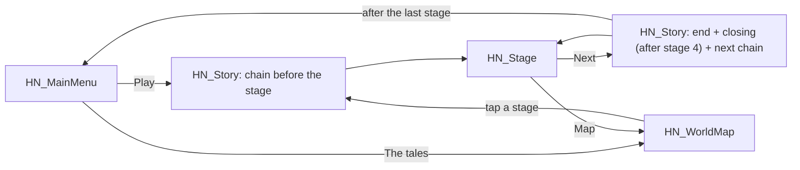

# Project Memory (CLAUDE.md)

> This file is automatically loaded by Claude Code at the start of every session.
> Keep it short and high-signal: Claude reads it every time, so every line costs context.
> Replace the placeholders below with your real project info.

## Project Overview

- **Name:** **Timucuha n Mqidec, the tales of Mqidec** (Unity project folder `game1`; the
  Player Settings product name is still "Hollow Night", an open question).
- **What it does:** 2D physics puzzle game for mobile portrait, told by Jida, a Kabyle
  grandmother, at the hearth. Drag to aim, release to launch Mqidec, a small black rabbit; break
  Teryel the ogress's hunting pots, use her kitchen against her, reach the door. Slice 1 is
  **Night 1** (stages 1-4) in four languages (Taqbaylit, French, Arabic, English).
  Design record: `SPEC.md` (2026-10-21, supersedes the 2026-10-12 pumpkin game). Everything (UI,
  levels, audio) is built from code at runtime; scenes contain a single `GameBoot` object.
- **Tech stack:** Unity **6000.6.5f1** (Unity 6, upgraded from 2019.3 on 2026-10-12), C# code
  kept at **7.3** style, **built-in render pipeline** (URP removed, all sprites use `Sprites/Default`),
  Physics2D, legacy `Input`, `UnityEngine.UI` (no TextMeshPro). Python 3 + Pillow for tooling.
- **Package manager:** none (Unity Package Manager via `Packages/manifest.json`).
  No `package.json`, so the npm-based hooks in `.claude/hooks/` pass through untouched.

## Essential Commands

Unity Hub and editor 6000.6.5f1 are installed at `~/Unity/Hub/Editor/6000.6.5f1`. Claude cannot
drive the editor; the user play-tests and pastes Console output. Never claim a Unity test ran.

```bash
# All commands run from the project root (this folder)
# Compile every Unity assembly with the editor's own compiler, run the plain C# tests (~5 s)
bash Tools/unity_check.sh

# Every stage finishable with three stars and its lesson (physics simulator; use seeds 1, 5, 9)
python3 Tools/check_levels.py
python3 Tools/check_levels.py 2 4 --seed 5

# Text: edit Tools/design/yennayer-script.md, then regenerate Logic/TalesText.cs and text.js
python3 Tools/design/original/build-text.py
python3 Tools/check_glyphs.py      # every character exists in its language's font

# Regenerate the procedural sprites in Assets/Resources/HN/ (keeps .meta GUIDs)
python3 Tools/generate_art.py

# Code knowledge graph (use before opening .cs files; AST-only, no API cost)
graphify query "how does the hero come to rest"
graphify update .

```

## Architecture Notes

- This folder is the git repo. `Library/`, `Temp/`, `obj/`, `Logs/` and IDE files are ignored.
- **AI tooling** (`.claude/`, `.agents/`, `.codex/`, `scripts/`, `CATALOG.md`,
  `TEMPLATE_README.md`) is shared by Claude Code and Codex. Edit `.claude/` only, then run
  `bash scripts/sync-codex.sh`; never edit `.agents/skills/` directly.
- **The full game guide is the "Game guide" section below**: folder map, scene flow, hero
  rules, how to add a stage, verification steps. Read it before touching code.
- Game code: `Assets/Scripts/HollowNight/{Core,UI,Story,Stage,Elements}/`. Pure rules live in
  `Logic/` (asmdef `HollowNight.Logic`, `noEngineReferences`): text table, Arabic layout, star and
  door rules, the pot's state step, the story order. Tests in `Tools/unity_tests/` use only it.
  Entry point is `Core/GameBoot.cs` (its `.meta` GUID must never change).
  Scenes: `Assets/Scenes/HollowNight/HN_{MainMenu,WorldMap,Story,Stage}.unity`.
  Art and fonts: `Assets/Resources/HN/`, loaded by name through `Art.Get`.
- Stages are data in `Stage/LevelLibrary.cs` using the fluent `LevelData` DSL. The
  simulator parses that file, so keep one call per line with plain numbers.
- Legacy prototype (`Assets/*.cs`, `Assets/Scripts/*.cs`, old `.unity` scenes)
  is disabled in the build. Never rename its classes or public fields; they are wired in scenes.
- Never read or edit `Library/`, `Temp/`, `obj/`, `Logs/`, `*.csproj`, `*.sln`, or existing
  `.meta` files. Non-asset files go in `Tools/` (docs may also live in the root), not `Assets/`.
- Status as of 2026-10-27 (branch `feat/unity-tales-slice1`): Night 1 compiles with 0 errors
  in every assembly (`Tools/unity_check.sh`), its tests pass, and all 4 stages pass the
  simulator with three stars. It is **not yet play-tested in the editor** (user gate).
  `Hollow Night > Smoke Test (all stages)` in the editor menu (`Assets/Editor/HNSmokeTest.cs`)
  taps through the story chain, plays every stage and writes `Tools/smoke_report.txt`.

## Rules

Detailed conventions live in `.claude/rules/` and are loaded automatically:

- @.claude/rules/code-style.md
- @.claude/rules/pr.md
- @.claude/rules/workflow.md
- @.claude/rules/delivery.md
- @.claude/rules/reporting.md

API conventions load on demand as a skill (`.claude/skills/api-conventions/`) —
only sessions that touch an API pay for them. (This project has no HTTP API.)

## Session & Context Hygiene

- When compacting this conversation, always preserve the full list of modified
  files, the current task plan status, and any test commands used.
- Unrelated new task → suggest starting a fresh session instead of continuing here.
- Use `graphify query` / the Game guide first; open a `.cs` file only for exact lines.

## Hard Constraints (always follow)

- Never commit secrets, API keys, or `.env` files.
- Never push directly to `main` — always work on a feature branch.
- Run `python3 Tools/check_levels.py` (and the compile check when available) before
  claiming a task is complete. Never claim a Unity play-test that did not happen.
  The Stop hook `.claude/hooks/done-gate.sh` enforces this and the browser prototype
  tests, re-running an area only when it changed since its checks last passed
  (tests: `bash .claude/hooks/done-gate.test.sh`).
- Use Unity 6 APIs (`linearVelocity`, `linearDamping`, `angularDamping`); keep code simple C# 7.3 style.
- After changing game code: run `graphify update .` and update the Game guide below.
- Prefer editing existing files over creating new ones.

## Game guide

### 1. What this project is

**Timucuha n Mqidec**: Jida tells her grandchildren how Mqidec, a rabbit no bigger than a fist,
outwits the ogress Teryel. Each night is a tale of four stages; slice 1 holds Night 1, Teryel's
kitchen. The story, nights and mechanics come from the browser prototype in
`Tools/design/original/`; `SPEC.md` (2026-10-21) records the port.

The project contains two generations of code:

| Part | Location | Status |
|---|---|---|
| **The tales** (the game) | `Assets/Scripts/HollowNight/`, `Assets/Scenes/HollowNight/`, `Assets/Resources/HN/` | Active, in the build. Namespace and folders keep the old "HollowNight" name |
| First prototype | `Assets/*.cs`, `Assets/Scripts/*.cs`, `Assets/Scenes/*.unity` | Legacy, **disabled in the build** |

| Item | Value |
|---|---|
| Unity version | **6000.6.5f1** (Unity 6). Code stays in plain C# 7.3 style |
| Render pipeline | **Built-in**. All sprites use the unlit `Sprites/Default` material |
| Input | Legacy `Input` class (mouse = first touch) |
| Physics | Physics2D, gravity (0, -9.81), hero gravity scale 1.5 |
| UI | `UnityEngine.UI` built from code; no TextMeshPro. Arabic is shaped by `Logic/ArabicText` |
| Target | Android/iOS portrait later; slice 1 plays in the editor |
| Verification | `Tools/unity_check.sh`, `Tools/check_levels.py`; the user play-tests. See §9 |

### 2. Key design decision: everything is built from code

Each Hollow Night scene contains **one GameObject** with one component, `GameBoot`, whose `screen`
field selects what to build. Camera, UI, levels, audio and effects are created at runtime.

Consequences:
- Never wire things in the Inspector for the new game; there is nothing to wire.
- Sprites and fonts are loaded by name with `Art.Get("name")` from `Assets/Resources/HN/`.
- Any `MonoBehaviour` is attached with `AddComponent<T>()`. Several classes share one file
  (for example `Elements.cs`); that is fine because they are never attached in the Editor.
  Only `GameBoot` must stay in a file with its own name, and its `.meta` GUID must not change.

### 3. Folder map

| Path | Content |
|---|---|
| `Assets/Scripts/HollowNight/Logic/` | Pure C# (no UnityEngine): `TalesText` (generated) and `Text`, `ArabicText`, `Rules`, `PotStep` (`Pot`), `TalesStory` |
| `Assets/Scripts/HollowNight/Core/` | `GameBoot`, `Art`, `Flow`, `Progress`, `Heroes`, `Sfx`, `Juice` |
| `Assets/Scripts/HollowNight/UI/` | `UIKit` (incl. `Say`, `T`), `MainMenuScreen`, `WorldMapScreen` |
| `Assets/Scripts/HollowNight/Story/` | `Story` (scenes, portraits, night card), `StoryScreen` |
| `Assets/Scripts/HollowNight/Stage/` | `StageController`, `StageHud`, `Hero`, `CameraRig` (+`Trajectory`), `LevelData`, `LevelBuilder`, `LevelLibrary` |
| `Assets/Scripts/HollowNight/Elements/` | `Elements.cs` (all level objects: `Hunter`, `Jar`, `Teryel`...), `WitchBoss.cs` (unused by Night 1) |
| `Assets/Resources/HN/` | Sprites (placeholders for the tales) + `Fonts/` (Noto Sans, Noto Sans Arabic, Creepster, Luckiest Guy, with licences) |
| `Tools/design/yennayer-script.md` | **The script**: every line in four languages. Source of `TalesText.cs` and the browser's `text.js` |
| `Tools/design/original/` | The browser prototype of the tales (reference for rules, layouts and story order) |
| `Tools/generate_art.py` | Regenerates the sprites (Pillow). Keeps existing `.meta` GUIDs |
| `Tools/check_levels.py` | Simulates the stages: three stars with the stage's lesson |
| `Tools/unity_check.sh`, `Tools/unity_tests/` | Compile gate and plain C# tests |
| `Tools/check_glyphs.py` | Font coverage of every character per language |
| `Assets/Editor/HNSmokeTest.cs` | Editor menu `Hollow Night > Smoke Test`: story chain and every stage, writes `Tools/smoke_report.txt` |
| `Assets/AlienTileSet/`, `Assets/2D Halloween Decoration/`, `Assets/QS/` | Third-party art packs, no logic |
| `Library/`, `Temp/`, `Logs/`, `obj/`, `*.csproj`, `*.sln` | Generated by Unity. **Never read or edit** |
| `graphify-out/` | Code knowledge graph (§10) |

### 4. Scene flow

Build order: `HN_MainMenu` (0), `HN_WorldMap` (1), `HN_Story` (2), `HN_Stage` (3).
Scenes are loaded **by name** through `Flow.Go(...)`, which fades the screen (a load asked for
during another waits its turn).



`TalesStory.BeforeStage` gives the chain: the first time a night is told, `opening`, then
`first_night` (Mqidec's naming, once ever), then `night_N`; then `stage_N` once.
`TalesStory.AfterStage` adds `end_N` and `closing` after the night's last stage, through "Next"
only. One `StoryScreen` plays the whole chain (`Flow.Stories`), then marks every id seen.
State that survives a scene load is static: `Flow.Level`, `Flow.Stories`, `Flow.AfterStory`.
`HN_Stage` is one scene for all stages; it builds `LevelLibrary.Get(Flow.Level)`.

### 5. Core classes

| Class | Responsibility |
|---|---|
| `GameBoot` | Creates the camera and event system, then adds the screen component |
| `Flow` / `FlowRunner` | Navigation, fade overlay, story chains before and after stages |
| `Progress` | PlayerPrefs save under `tm_` keys: `done_N`, `stars_N`, `best_N`, `story_ID`, `lang`, `sound`; `CurrentLevel` |
| `Art` | Sprite/font cache, `Make`, `MakeSliced`, `Layer` sorting orders, `LatinFont`/`ArabicFont` |
| `Sfx` | Synthesises every sound at runtime (Clink, Crack, Crush for the clay). `Sfx.Play(Sound.X)` |
| `UIKit` | Canvas, labels, buttons. **`UIKit.Say(label, text)`** sets text in the chosen language (Arabic shaped and right to left, font fallback); `UIKit.T(id)` reads the table |
| `TalesText` / `TalesStory` (Logic) | Every line in four languages; the beats of each story and their order |
| `Story` / `StoryScreen` | Scene backdrops, portraits, night card; plays a chain with an Arabic typewriter |
| `StageController` | Singleton `StageController.I`. Input, broken list, Teryel count, door, win, pause |
| `StageHud` | Stage title, three stars, hints, pause and result panels (texts from ids) |
| `Hero` | Hero physics, states, the dash, squash-and-stretch |
| `LevelData` / `LevelBuilder` / `LevelLibrary` | Fluent stage description, its GameObjects, the 4 stages |

### 6. Gameplay rules

#### Hero states (`HeroState`)
`Resting` (kinematic, follows the ground it stands on, can be launched) → `Flying` (dynamic) →
`Resting` again when grounded and slower than 0.6 for 0.12 s. Also `Cannon`, `Dead`, `Won`.
`Hero.Rest` never saves a respawn spot inside a free Teryel's path (`Teryel.InPath`).

#### Input (`StageController.Update`)
- Press and drag while `Resting`: aim (max 4 world units, velocity `drag / 4 * maxSpeed`, exact
  preview). While a real aim is held, `StageController.Aiming` freezes the pots.
- Press while `Flying`: the dash. A drag shorter than 0.45 units is ignored.
- `R` restarts, `Esc` pauses.

#### Hero (`Heroes.cs`)
Mqidec (`HeroType.Izan` in code, sprites `izan_*`) is the only hero: launch speed 16, one Spirit
Dash per flight (tap in the air, 0.45 s, breaks pots). Name and hint are text ids (`hero.name`,
`tip.dash`). The other `HeroType` values only keep `Hero.cs` compiling.

#### Pots (`Hunter` + `Logic/PotStep.cs`)
Kinematic triggers driven by `Pot.Step`: idle, notice (0.35 s), hunt (speed x1.6, lunge x1.8
within 1.6), give up beyond 1.4 x range, return home. A dash or an impact over 4.5 breaks one; a
slower touch kills. From a death until the next launch every pot is sent home and is harmless
(`PotsSafe`). `Sleeper` is a pot with range 0.

#### Jars (`Jar`)
Dynamic, rotation frozen (the roll is drawn). The hero passes through and kicks it (every 0.4 s
of contact) with most of his horizontal speed. It breaks pots it bowls into, shatters after a fall
of 2.5+ (crushing pots within 1.1), against a side wall above 3, or off the stage. The trap jar
rolls out again 1.2 s after breaking while Teryel is free.

#### Teryel (`Teryel`)
Never fought: any touch kills, even a dash (respawn grace respected). Can patrol (`dx`, `period`).
A moving jar traps her; then `StageController.TeryelTrapped` may open the door.

#### Stars and door (`Logic/Rules.cs`)
One star per hunter broken, up to 3: pots, sleepers and rolling jars count, the trap jar never.
Finishing alone gives no star; there is no par. Door modes: `Always` (stages 1-3) or `Trap`
(stage 4: opens once every Teryel is trapped).

#### Level objects (`Kind` in `LevelData.cs`, classes in `Elements.cs`)
Night 1 uses `Platform`, `Door`, `Pot`, `Sleeper`, `Jar`, `TrapJar`, `Teryel`, `Cauldron` (the
hearth cannon: 0.4 s, set velocity) and `Ghost` (the crumbling ledge, phase from the stage start).
Kept for later nights: `Key`, `Spikes`, `Mushroom`, `Mover`, `Wind`, `Portal`, `Bat`, `Crate`,
`Web`, `Decor`, `Boss`.

#### World units
x from -6 to 6 (walls at ±6), y = 0 is the ground surface. Hero radius 0.45.
The camera always shows 12 units of width and follows the hero vertically.

### 7. How to add or change a stage

Edit `LevelLibrary.cs`. One call per line, plain numbers (the simulator parses this file):

```csharp
static LevelData Level5()
{
    return New(5, 16f)                 // id, height (name comes from text id stage.5)
        .Rules(DoorMode.Trap)          // optional; default Always
        .Hint("tip.roll")              // a teaching card id, shown until the first launch
        .Ground()
        .Start(-4.5f, 0f)
        .Ledge(2f, 5f, 3f)             // x, surface height, width
        .Door(2.5f, 5f)                // x, surface
        .Pot(0f, 4f, 3f, 0.9f)         // centre x, y, range, speed
        .Jar(-3f, 0f);                 // x, surface
}
```

Then: add it to `Build()`; the stage and story counts come from `TalesStory` (`Nights`,
`StagesPerNight`), and its lines and beats go in `TalesStory` and the script. Run
`bash Tools/unity_check.sh` and `python3 Tools/check_levels.py 5` (with seeds 5 and 9).

To add a new kind of object: add a `Kind`, a fluent method in `LevelData`, a builder method in
`LevelBuilder`, the behaviour class in `Elements.cs`, and teach `Tools/check_levels.py` about it
(and its lesson flag if the stage teaches it).

### 8. Legacy prototype

Kept for reference, not part of the build. Scripts: `GameManager`, `PLayer_drag_drop`,
`trajectory_Script`, `door_Scrip`, `pumkinkScript`, `level_Loader`, `button_Press`,
`LegacyButton` (base of `button_menu_`, `button_next_`, `button_restart_`), `CharacterController2D`,
`start_left/middel/right`, and unused tests `izanScript`, `carecterScript`, `player_script`, `balltest`, `bbbb`.

Rules for legacy code: its connections live in `Level_1.unity` and `Menu_start.unity`, so **never rename**
its classes, files or public fields (typos such as `desactivaterb`, `whaite`, `helth` are part of the API).
To play it, enable the three legacy scenes in Build Settings.

### 9. Verification

Claude cannot drive the Unity editor, so:

| Check | How | Covers |
|---|---|---|
| Compile | `bash Tools/unity_check.sh` (editor's compiler and engine assemblies; Logic, Assembly-CSharp in editor and player defines, Editor) | Syntax, types, API names, Logic purity |
| Logic tests | Same script (`Tools/unity_tests/`) | Arabic layout, text table, stars and doors, pot step, story order, every text id used in code |
| Stages | `python3 Tools/check_levels.py` (seeds 1, 5, 9) | A three-star route using the stage's lesson (roll, cannon, trapped) |
| Text and fonts | `python3 Tools/check_glyphs.py` | Every character in its language's font |
| Play test | **Open in Unity and play**, then `Hollow Night > Smoke Test` | Everything else: scenes, sprites, feel, Arabic on screen |

`check_levels.py` is a random search over an approximation of the physics. Jars, Teryel and the
door modes are simulated; pots stay at home (no hunt), so the chase is only judged in the editor.
Never claim a change was tested in Unity unless it was.

### 10. Code knowledge graph (Graphify)

`graphify-out/graph.json` holds a graph of all C# code. Use it before opening files:

```bash
graphify query "how does the hero come to rest"
graphify explain "StageController"
graphify path "Cauldron" "Hero"
graphify affected "LevelData"
graphify update .        # after changing code
```

The graph indexes source code, including Unity C# and the isolated browser prototype.
`.graphifyignore` excludes generated folders, art packs and binary assets.

#### Browser exploration (2026-10-14)

The user approved the plan in `task_plan.md` for a parallel-agent browser comparison.
The adult directions are **The Last Light**, **The Borrowed Shadow**, and **The Thirteenth Bell**.
Story/mechanic and art can be selected independently. Distinct signature layouts appear
in redesigned stages 3, 6 and 10; the other stages share a learning sequence.
Production story/art/mechanic selection remains pending; `SPEC.md` still records the
October 12 Unity design. Do not treat browser proposals as approved Unity changes.

Prototype checks: `node Tools/design/prototype/game.test.js`,
`node Tools/design/prototype/art.test.js`, and
`node Tools/design/prototype/verify-routes.js`. Stored solutions execute normal browser
physics and victory. They do not prove Unity parity, optimal par, or player enjoyment.
Baseline stage 9's browser route uses six launches against par five. Some proposed
routes bypass crates/moving platforms; compulsory mechanic teaching needs playtesting.
The browser art is original procedural concept drawing, not imported production assets.

### 11. Rules for AI assistants

- Check this guide and the graph first; open a `.cs` file only when you need its exact lines.
- New art goes through `Tools/generate_art.py` or as a PNG in `Assets/Resources/HN/`.
- Editing limits, Unity 6 API names and after-change steps: see Architecture Notes and Hard Constraints above.

## graphify

This project has a knowledge graph at graphify-out/ with god nodes, community structure, and cross-file relationships.

Rules:
- For codebase questions, first run `graphify query "<question>"` when graphify-out/graph.json exists. Use `graphify path "<A>" "<B>"` for relationships and `graphify explain "<concept>"` for focused concepts. These return a scoped subgraph, usually much smaller than GRAPH_REPORT.md or raw grep output.
- If graphify-out/wiki/index.md exists, use it for broad navigation instead of raw source browsing.
- Read graphify-out/GRAPH_REPORT.md only for broad architecture review or when query/path/explain do not surface enough context.
- After modifying code, run `graphify update .` to keep the graph current (AST-only, no API cost).
