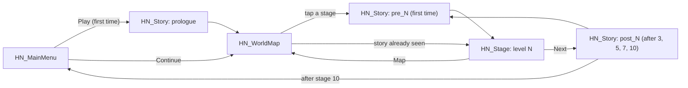
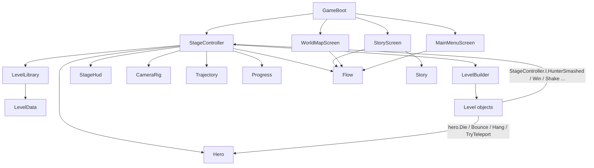

# Project Memory (CLAUDE.md)

> This file is automatically loaded by Claude Code at the start of every session.
> Keep it short and high-signal: Claude reads it every time, so every line costs context.
> Replace the placeholders below with your real project info.

## Project Overview

- **Name:** **Hollow Night: Izan and the Pumpkin Hunt** (Unity project folder `game1`).
- **What it does:** 2D Halloween physics puzzle game for mobile portrait. Drag to aim,
  release to launch Izan the black rabbit, smash the glowing pumpkins that hunt him,
  reach the door. One hero, 10 stages in 3 chapters, a witch boss, story screens.
  Design record: `SPEC.md` (redesign of 2026-10-12). Everything (UI, levels, audio) is built from
  code at runtime; scenes contain a single `GameBoot` object.
- **Tech stack:** Unity **6000.6.5f1** (Unity 6, upgraded from 2019.3 on 2026-10-12), C# code
  kept at **7.3** style, **built-in render pipeline** (URP removed, all sprites use `Sprites/Default`),
  Physics2D, legacy `Input`, `UnityEngine.UI` (no TextMeshPro). Python 3 + Pillow for tooling.
- **Package manager:** none (Unity Package Manager via `Packages/manifest.json`).
  No `package.json`, so the npm-based hooks in `.claude/hooks/` pass through untouched.

## Essential Commands

Unity Hub and editor 6000.6.5f1 are installed at `~/Unity/Hub/Editor/6000.6.5f1`. Claude cannot
drive the editor; the user play-tests and pastes Console output. Never claim a Unity test ran.

```bash
# All commands run from the project root (this folder)
# Verify every stage is finishable (physics simulator; vary --seed when a stage is near par)
python3 Tools/check_levels.py
python3 Tools/check_levels.py 4 7 --seed 5

# Regenerate the procedural sprites in Assets/Resources/HN/ (keeps .meta GUIDs)
python3 Tools/generate_art.py

# Code knowledge graph (use before opening .cs files; AST-only, no API cost)
graphify query "how does the hero come to rest"
graphify update .

# Compile check: open the project in Unity; Library/ScriptAssemblies/Assembly-CSharp.dll
# timestamp and Logs/Editor.log (grep 'error CS') show the result.
```

## Architecture Notes

- This folder is the git repo. `Library/`, `Temp/`, `obj/`, `Logs/` and IDE files are ignored.
- **AI tooling** (`.claude/`, `.agents/`, `.codex/`, `scripts/`, `CATALOG.md`,
  `TEMPLATE_README.md`) is shared by Claude Code and Codex. Edit `.claude/` only, then run
  `bash scripts/sync-codex.sh`; never edit `.agents/skills/` directly.
- **The full game guide is the "Game guide" section below**: folder map, scene flow, hero
  rules, how to add a stage, verification steps. Read it before touching code.
- Game code: `Assets/Scripts/HollowNight/{Core,UI,Story,Stage,Elements}/`.
  Entry point is `Core/GameBoot.cs` (its `.meta` GUID must never change).
  Scenes: `Assets/Scenes/HollowNight/HN_{MainMenu,WorldMap,Story,Stage}.unity`.
  Art and fonts: `Assets/Resources/HN/`, loaded by name through `Art.Get`.
- Stages are data in `Stage/LevelLibrary.cs` using the fluent `LevelData` DSL. The
  simulator parses that file, so keep one call per line with plain numbers.
- Legacy prototype (`Assets/*.cs`, `Assets/Scripts/*.cs`, old `.unity` scenes)
  is disabled in the build. Never rename its classes or public fields; they are wired in scenes.
- Never read or edit `Library/`, `Temp/`, `obj/`, `Logs/`, `*.csproj`, `*.sln`, or existing
  `.meta` files. Non-asset files go in `Tools/` (docs may also live in the root), not `Assets/`.
- Status as of 2026-10-12: project opens in Unity 6 and compiled with 0 errors before the
  pumpkin-hunt redesign; the redesign itself is **not yet compile-checked or play-tested**.
  All 10 stages pass the simulator. `Hollow Night > Smoke Test (all stages)` in the editor
  menu (from `Assets/Editor/HNSmokeTest.cs`) plays every screen and writes `Tools/smoke_report.txt`.

## Rules

Detailed conventions live in `.claude/rules/` and are loaded automatically:

- @.claude/rules/code-style.md
- @.claude/rules/pr.md
- @.claude/rules/workflow.md
- @.claude/rules/delivery.md
- @.claude/rules/reporting.md

API conventions load on demand as a skill (`.claude/skills/api-conventions/`) —
only sessions that touch an API pay for them. (This project has no HTTP API.)

## Session & Context Hygiene

- When compacting this conversation, always preserve the full list of modified
  files, the current task plan status, and any test commands used.
- Unrelated new task → suggest starting a fresh session instead of continuing here.
- Use `graphify query` / the Game guide first; open a `.cs` file only for exact lines.

## Hard Constraints (always follow)

- Never commit secrets, API keys, or `.env` files.
- Never push directly to `main` — always work on a feature branch.
- Run `python3 Tools/check_levels.py` (and the compile check when available) before
  claiming a task is complete. Never claim a Unity play-test that did not happen.
  The Stop hook `.claude/hooks/done-gate.sh` enforces this and the browser prototype
  tests, re-running an area only when it changed since its checks last passed
  (tests: `bash .claude/hooks/done-gate.test.sh`).
- Use Unity 6 APIs (`linearVelocity`, `linearDamping`, `angularDamping`); keep code simple C# 7.3 style.
- After changing game code: run `graphify update .` and update the Game guide below.
- Prefer editing existing files over creating new ones.

## Game guide

### 1. What this project is

**Hollow Night: Izan and the Pumpkin Hunt** — a 2D Halloween physics puzzle game for mobile (portrait).
The player drags to aim and releases to launch Izan, a black rabbit hunted by glowing pumpkins. Smashing
every pumpkin unseals the door. It has a story, one hero, 10 stages in 3 chapters and a boss fight.
The agreed design is in `SPEC.md` (2026-10-12).

The project contains two generations of code:

| Part | Location | Status |
|---|---|---|
| **Hollow Night** (the game) | `Assets/Scripts/HollowNight/`, `Assets/Scenes/HollowNight/`, `Assets/Resources/HN/` | Active, in the build |
| First prototype | `Assets/*.cs`, `Assets/Scripts/*.cs`, `Assets/Scenes/*.unity` | Legacy, bugs fixed, **disabled in the build** |

| Item | Value |
|---|---|
| Unity version | **6000.6.5f1** (Unity 6, upgraded 2026-10-12). Code stays in plain C# 7.3 style |
| Render pipeline | **Built-in** (URP assets removed at upgrade). All sprites use the unlit `Sprites/Default` material |
| Input | Legacy `Input` class (mouse = first touch) |
| Physics | Physics2D, gravity (0, -9.81), hero gravity scale 1.5 |
| UI | `UnityEngine.UI` built from code. TextMeshPro is **not** used |
| Target | Android/iOS portrait. Product name `Hollow Night` |
| Version control | git repository in `game1/`; generated folders are ignored |
| Verification | Unity 6 is installed; the user play-tests. See §9 |

### 2. Key design decision: everything is built from code

Each Hollow Night scene contains **one GameObject** with one component, `GameBoot`, whose `screen`
field selects what to build. Camera, UI, levels, audio and effects are created at runtime.

Consequences:
- Never wire things in the Inspector for the new game; there is nothing to wire.
- Sprites and fonts are loaded by name with `Art.Get("name")` from `Assets/Resources/HN/`.
- Any `MonoBehaviour` is attached with `AddComponent<T>()`. Several classes share one file
  (for example `Elements.cs`); that is fine because they are never attached in the Editor.
  Only `GameBoot` must stay in a file with its own name, and its `.meta` GUID must not change.

### 3. Folder map

| Path | Content |
|---|---|
| `Assets/Scripts/HollowNight/Core/` | `GameBoot`, `Art`, `Flow`, `Progress`, `Heroes`, `Sfx`, `Juice` |
| `Assets/Scripts/HollowNight/UI/` | `UIKit`, `MainMenuScreen`, `WorldMapScreen` |
| `Assets/Scripts/HollowNight/Story/` | `Story` (all dialogue), `StoryScreen` |
| `Assets/Scripts/HollowNight/Stage/` | `StageController`, `StageHud`, `Hero`, `CameraRig` (+`Trajectory`), `LevelData`, `LevelBuilder`, `LevelLibrary` |
| `Assets/Scripts/HollowNight/Elements/` | `Elements.cs` (all level objects), `WitchBoss.cs` |
| `Assets/Scenes/HollowNight/` | `HN_MainMenu`, `HN_WorldMap`, `HN_Story`, `HN_Stage` |
| `Assets/Resources/HN/` | 100 sprites + `Fonts/` (Creepster, Luckiest Guy, with licences) |
| `Tools/generate_art.py` | Regenerates the sprites (Pillow). Keeps existing `.meta` GUIDs |
| `Tools/check_levels.py` | Simulates the stages to test that they can be finished |
| `Tools/design/prototype/` | Isolated HTML/CSS/JS comparison: current AI-reworked ten Unity layouts, ten proposals, three adult story/art directions. The user's handmade legacy scenes are documented in `Tools/design/original-scenes.md`; not part of the Unity build |
| `Assets/Editor/HNSmokeTest.cs` | Editor menu `Hollow Night > Smoke Test`: plays every screen/stage, writes `Tools/smoke_report.txt` |
| `Assets/AlienTileSet/`, `Assets/2D Halloween Decoration/`, `Assets/QS/` | Third-party art packs, no logic |
| `Library/`, `Temp/`, `Logs/`, `obj/`, `*.csproj`, `*.sln` | Generated by Unity. **Never read or edit** |
| `graphify-out/` | Code knowledge graph (§10) |

### 4. Scene flow

Build order: `HN_MainMenu` (0), `HN_WorldMap` (1), `HN_Story` (2), `HN_Stage` (3).
Scenes are loaded **by name** through `Flow.Go(...)`, which fades the screen.



State that survives a scene load is static: `Flow.Level`, `Flow.StoryId`, `Flow.AfterStory`.
`HN_Stage` is one scene for all stages; it builds `LevelLibrary.Get(Flow.Level)`.

### 5. Core classes

| Class | Responsibility |
|---|---|
| `GameBoot` | Creates the camera and event system, then adds the screen component |
| `Flow` / `FlowRunner` | Navigation, fade overlay, story-before-level logic |
| `Progress` | PlayerPrefs save: `hn_done_N`, `hn_stars_N`, `hn_best_N`, `hn_story_ID`, `hn_sound` |
| `Art` | Sprite/font cache, `Make` (fit to a world height), `MakeSliced` (9-slice), `Layer` sorting orders |
| `Sfx` | Synthesises every sound and the music loop at runtime. `Sfx.Play(Sound.X)` |
| `Juice.cs` | `Ease`, `Tween`, `Bob`, `Spin`, `Pulse`, `FrameLoop`, `Mote`, `Fx` (sprite particle bursts) |
| `UIKit` | Canvas (reference 1080x1920), labels, pictures, buttons, `PointerOverUI()` |
| `Story` | Dialogue data: `prologue`, `pre_1..10`, `post_3/5/7/10`. `Story.ChapterOf(level)` |
| `StageController` | Singleton `StageController.I`. Input, score, win/lose, pause |
| `StageHud` | Score bar, hints, pause and result panels |
| `Hero` | Hero physics, states, abilities and squash-and-stretch animation |
| `LevelData` | Fluent level description (`.Ledge()`, `.Hunter()`, `.Door()` ...) |
| `LevelBuilder` | Turns `LevelData` into GameObjects |
| `LevelLibrary` | The 10 stages |



### 6. Gameplay rules

#### Hero states (`HeroState`)
`Resting` (kinematic, follows the ground it stands on, can be launched) → `Flying` (dynamic) →
`Resting` again when grounded and slower than 0.6 for 0.12 s. Also `Cannon`, `Dead`, `Won`.

#### Input (`StageController.Update`)
- Press and drag while `Resting`: aim. Drag is measured in screen space, max 4 world units.
  Launch **velocity** is set directly (`drag / 4 * maxSpeed`), so the trajectory preview is exact.
- Press while `Flying`: the hero's ability. A drag shorter than 0.45 units is ignored.
- `R` restarts, `Esc` pauses.

#### Hero (`Heroes.cs`)

Izan, the black rabbit, is the only playable hero (max launch speed 16). Ability: Spirit Dash, a tap in
flight that boosts speed for 0.45 s, smashes pumpkins and bats, and breaks crates. The `HeroType` enum
still lists Hoot, Webster and Pip and `Hero.cs` keeps their ability code so it compiles, but they are
not in the roster and no UI shows them. Sprites `izan_idle/blink/fly/happy/hurt` are drawn by
`izan()` in `Tools/generate_art.py` to match the first prototype's rabbit.

#### Hunting pumpkins (`Hunter` in `Elements.cs`)
Floating kinematic trigger (`useFullKinematicContacts` so it also touches the resting hero). Inside
`Range` (3.5) it drifts toward the hero at `Speed` (1.2); otherwise it floats home. A dashing hero or an
impact faster than `BreakSpeed` (4.5) smashes it (hero keeps 60 % of its speed); a slower touch kills the
hero, after which the pumpkin waits at home until the next launch so a respawn is never camped. Sprites `hunter_0/1`
come from the legacy `Assets/graphics/Texture/Jack o lantern_3.png`.

#### Score
Stars: 1 for finishing, +1 for smashing every pumpkin, +1 for `launches <= par`. A death costs one launch
and respawns the hero at the last **stable** rest position. The door is sealed until every pumpkin in
the stage is smashed (a `Key` adds a lock on top).

#### Level objects (`Kind` in `LevelData.cs`, classes in `Elements.cs`)
`Platform`, `Door` (locked by `Key`; sealed while any `Hunter` is alive), `Hunter`, `Spikes`,
`Mushroom` (bounce 17), `Mover`, `Wind`, `Portal`, `Bat`, `Cauldron` (cannon), `Crate` (cracked block),
`Ghost` (blinking platform), `Web`, `Decor`, `Boss`.

The boss (`WitchBoss`) has 3 health, rises 2.2 units and speeds up after each hit, throws `Bomb`s,
and drops the `LanternGoal` when defeated; touching the lantern wins stage 10.

#### World units
x from -6 to 6 (walls at ±6), y = 0 is the ground surface. Hero radius 0.45.
The camera always shows 12 units of width and follows the hero vertically.

### 7. How to add or change a stage

Edit `LevelLibrary.cs`. One call per line, plain numbers (the simulator parses this file):

```csharp
static LevelData Level11()
{
    return New(11, "New Stage", HeroType.Izan, 24f, 4)   // id, name, hero, height, par
        .Hint("Shown until the first launch.")
        .Ground()
        .Start(-4f, 0f)
        .Ledge(2f, 5f, 3f)        // x, surface height, width
        .Door(2.5f, 5f)
        .Hunter(0f, 4f);      // floating pumpkin centre
}
```

Then: add it to `Build()`, raise `Progress.LevelCount`, update `Story.ChapterOf` and the world map
chapter starts if needed, add a `pre_11` dialogue in `Story.cs`, and run `python3 Tools/check_levels.py 11`.

To add a new kind of object: add a `Kind`, a fluent method in `LevelData`, a builder method in
`LevelBuilder`, the behaviour class in `Elements.cs`, and teach `Tools/check_levels.py` about it.

### 8. Legacy prototype

Kept for reference, not part of the build. Scripts: `GameManager`, `PLayer_drag_drop`,
`trajectory_Script`, `door_Scrip`, `pumkinkScript`, `level_Loader`, `button_Press`,
`LegacyButton` (base of `button_menu_`, `button_next_`, `button_restart_`), `CharacterController2D`,
`start_left/middel/right`, and unused tests `izanScript`, `carecterScript`, `player_script`, `balltest`, `bbbb`.

Rules for legacy code: its connections live in `Level_1.unity` and `Menu_start.unity`, so **never rename**
its classes, files or public fields (typos such as `desactivaterb`, `whaite`, `helth` are part of the API).
To play it, enable the three legacy scenes in Build Settings.

### 9. Verification

Claude cannot drive the Unity editor, so:

| Check | How | Covers |
|---|---|---|
| Compile | Open in Unity; check `Logs/Editor.log` for `error CS` | Syntax, types, API names |
| Stages | `python3 Tools/check_levels.py` | A route to the goal, every pumpkin smashed, par |
| Play test | **Open in Unity and play** | Everything else: scenes, sprite import, feel |

`check_levels.py` is a random search over an approximation of the physics; results vary slightly with
`--seed`. When a stage's best route is within one launch of par, test with several seeds. Hunters are
simulated at their home position (no chase): fast or dashing contact smashes them, slow contact is death.
`Hollow Night > Smoke Test (all stages)` in the editor plays everything and writes `Tools/smoke_report.txt`.

Never claim a change was tested in Unity unless it was.

### 10. Code knowledge graph (Graphify)

`graphify-out/graph.json` holds a graph of all C# code. Use it before opening files:

```bash
graphify query "how does the hero come to rest"
graphify explain "StageController"
graphify path "Cauldron" "Hero"
graphify affected "LevelData"
graphify update .        # after changing code
```

The graph indexes source code, including Unity C# and the isolated browser prototype.
`.graphifyignore` excludes generated folders, art packs and binary assets.

#### Browser exploration (2026-10-14)

The user approved the plan in `task_plan.md` for a parallel-agent browser comparison.
The adult directions are **The Last Light**, **The Borrowed Shadow**, and **The Thirteenth Bell**.
Story/mechanic and art can be selected independently. Distinct signature layouts appear
in redesigned stages 3, 6 and 10; the other stages share a learning sequence.
Production story/art/mechanic selection remains pending; `SPEC.md` still records the
October 12 Unity design. Do not treat browser proposals as approved Unity changes.

Prototype checks: `node Tools/design/prototype/game.test.js`,
`node Tools/design/prototype/art.test.js`, and
`node Tools/design/prototype/verify-routes.js`. Stored solutions execute normal browser
physics and victory. They do not prove Unity parity, optimal par, or player enjoyment.
Baseline stage 9's browser route uses six launches against par five. Some proposed
routes bypass crates/moving platforms; compulsory mechanic teaching needs playtesting.
The browser art is original procedural concept drawing, not imported production assets.

### 11. Rules for AI assistants

- Check this guide and the graph first; open a `.cs` file only when you need its exact lines.
- New art goes through `Tools/generate_art.py` or as a PNG in `Assets/Resources/HN/`.
- Editing limits, Unity 6 API names and after-change steps: see Architecture Notes and Hard Constraints above.

## graphify

This project has a knowledge graph at graphify-out/ with god nodes, community structure, and cross-file relationships.

Rules:
- For codebase questions, first run `graphify query "<question>"` when graphify-out/graph.json exists. Use `graphify path "<A>" "<B>"` for relationships and `graphify explain "<concept>"` for focused concepts. These return a scoped subgraph, usually much smaller than GRAPH_REPORT.md or raw grep output.
- If graphify-out/wiki/index.md exists, use it for broad navigation instead of raw source browsing.
- Read graphify-out/GRAPH_REPORT.md only for broad architecture review or when query/path/explain do not surface enough context.
- After modifying code, run `graphify update .` to keep the graph current (AST-only, no API cost).
